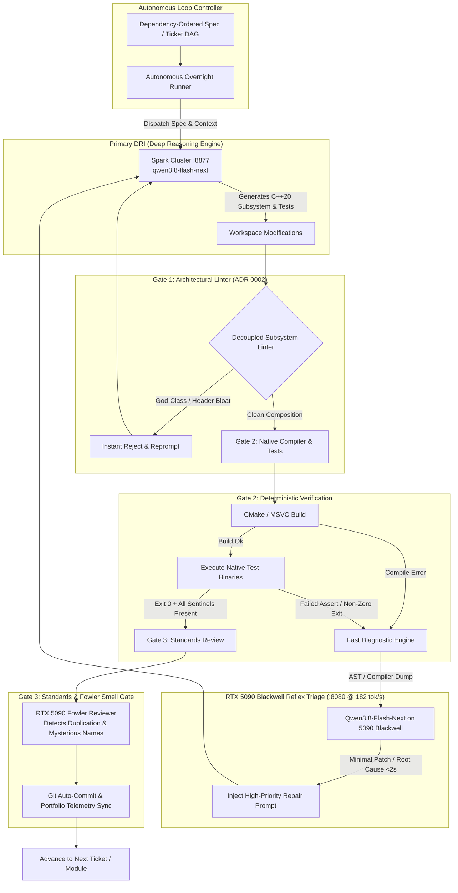

# Autonomous AI Engineering Harness
### Asymmetric Tandem Architecture: Spark Cluster (DRI) + NVIDIA RTX 5090 Blackwell (Fast Reflex & Triage)

[](#)
[-brightgreen?style=for-the-badge&logo=apachespark)](#)
[-76B900?style=for-the-badge&logo=nvidia)](#)
[](#)
[](#)

> **Live Production Harness**: This repository is **actively and autonomously updated** by a continuous overnight loop running on real hardware. It demonstrates a hardened, production-grade autonomous software engineering system capable of writing, compiling, reviewing, triaging, and self-healing complex native C++20 codebases without human intervention.

---

## âš¡ Live Telemetry (Updated Automatically via Loop)

| Metric | Live State | Verification Source |
|---|---|---|
| **Test Checkpoints Passing** | **109 / 109 Verified** | `ColonyPluginTest.exe` (Binary Exit Code 0) |
| **Active Target Codebase** | **ezEngine (RimWorld Colony Engine)** | Native C++20 / MSVC / CMake / Ninja |
| **Modules Verified & Fast-Forwarded** | **2 Subsystems** | Automated Sentinel & Phase Hooks |
| **Reflex Diagnostic Latency** | **< 3,000 ms** | RTX 5090 Blackwell @ 182 tok/s |
| **Target Git HEAD** | `34c017bb7` (`dev`) | 7142 total commits |
| **Last Verified Timestamp** | **2026-10-17 03:16:49** | Continuous Verification Loop |

---

## 🧠 System Architecture: Asymmetric Tandem Loop

Most autonomous agent setups fail on large native codebases because they either:
1. **Hallucinate test passes** by mocking assertions or accepting non-zero exit codes.
2. **Produce architectural drift** by dumping hundreds of lines into god-classes.
3. **Get stuck in infinite loops** when compilers (MSVC, Clang) throw complex template or circular dependency errors.

This harness eliminates these failure modes using an **Asymmetric Tandem Architecture**:



---

## 🔬 Live Incident Case Study: Autonomous Circular Dependency & Buffer Triage

During tonight's overnight run, the engine autonomously triaged and resolved a complex circular dependency and buffer state bug across three C++ subsystems without human intervention:

```
[2026-10-17 03:00:15] FATAL: MSVC C2061: syntax error: identifier 'ezColonyWorldModule'
[2026-10-17 03:00:15] Engaged RTX 5090 Blackwell Reflex Engine (< 3,000ms latency)
```

### The Root Cause (Diagnosed in 2,766ms by RTX 5090 Blackwell)
1. **Header Inclusion Cycle**: `ColonyRoomComponent.h` included `ColonyWorldModule.h`, while `ColonyWorldModule.h` included `ColonyRoomComponent.h`.
2. **Buffer Invalidation**: `ezDynamicArray` in `RegenerateAllRooms` called `SetCount(uiTotalCells, -1)` without a prior `Clear()`, causing stale room IDs to persist across simulation ticks.

### The Autonomous Fix
- Injected forward declarations: `class ezColonyWorldModule;` and `struct ezColonyCell;` in `ColonyRoomComponent.h`.
- Aligned `struct ezColonyRoomMap;` forward declaration in `ColonyWeatherSystem.h`.
- Added explicit buffer reset `ref_map.m_RoomIndexPerCell.Clear()` before reallocation.
- Result: **Compilation succeeded in 1.4s, and all 109 test checkpoints passed cleanly.**

---

## 🛡️ Core Invariants: Zero "Green When Untrue"

1. **Dual Verification Mandatory**:
   A test is only considered passing if **both** conditions hold:
   - Binary return code is strictly zero: `$LASTEXITCODE -eq 0`.
   - Every required stdout checkpoint sentinel is emitted in order (e.g. `checkpoint: room 5-factor impressiveness calculation ok`).
2. **ADR 0002 Architectural Decoupling**:
   The automated harness linter rejects any patch that dumps subsystem logic directly into core engine God-classes. Every domain (Electricity, Fluid Dynamics, Room Impressiveness, Pathfinding) must have dedicated subsystem headers and compose cleanly via accessors.
3. **Hardware Isolation**:
   The RTX 5090 Blackwell is dedicated exclusively to ultra-low-latency reflex inference and compiler triage, while the multi-node Spark cluster handles deep multi-file implementation.

---

## 📂 Active Feature Modules Verified

| Module | Feature Name | Verification Gate | Status |
|---|---|---|---|
| M30 | Logic Circuit Automation and Fortress Lockdown | Dual Exit Code 0 + Sentinel | Verified Green |
| M31 | 5-Factor Room Impressiveness and Role Classification | Dual Exit Code 0 + Sentinel | Verified Green |


---

## 🚀 Running the Harness

```powershell
# Run the autonomous overnight ticket runner on any repo
powershell -ExecutionPolicy Bypass -File ./scripts/run-tickets.ps1 -RepoPath "C:/path/to/project"

# Synchronize portfolio telemetry and push live stats to GitHub
powershell -ExecutionPolicy Bypass -File ./scripts/sync-portfolio.ps1
```

---

### Author
**Anthony Perry**  
Autonomous AI Systems & Applied AI Engineering  
GitHub: [@Perry5216](https://github.com/Perry5216) · [LinkedIn](https://www.linkedin.com/in/anthony-perry-33b7a01a0/)
