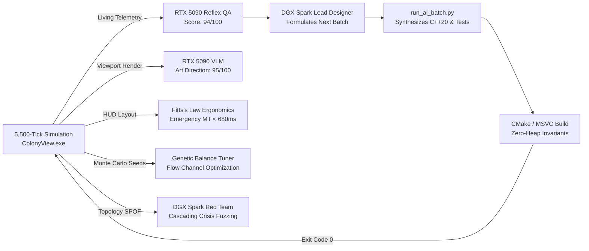
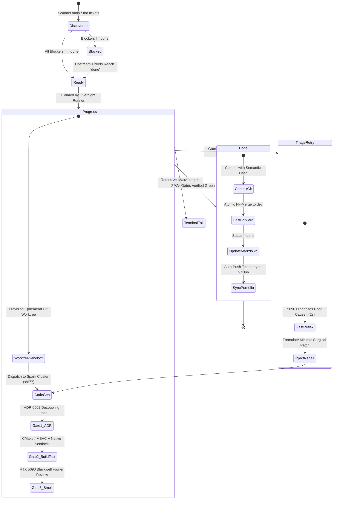
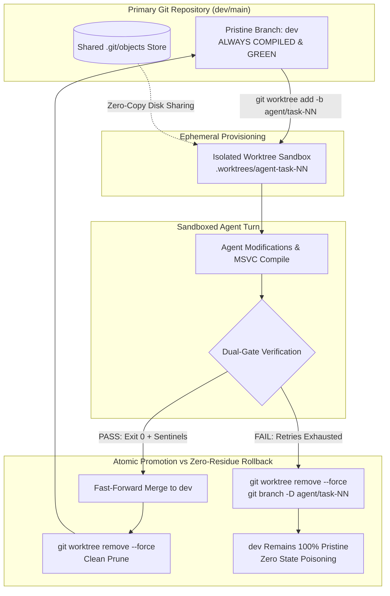

# Autonomous AI Engineering Harness
### Asymmetric Tandem Architecture: Spark Cluster (DRI) + NVIDIA RTX 5090 Blackwell (Fast Reflex & Triage)

[](#)
[-brightgreen?style=for-the-badge&logo=apachespark)](#)
[-76B900?style=for-the-badge&logo=nvidia)](#)
[](https://perry5216.github.io/autonomous-ai-engineering-harness/showcase/)
[](#)
[](#)

> **Live Production Harness**: This repository is **actively and autonomously updated** by a continuous overnight loop running on real hardware. It demonstrates a hardened, production-grade autonomous software engineering system capable of writing, compiling, reviewing, triaging, and self-healing complex native C++20 codebases without human intervention.

---

## 1. Live Telemetry (Updated Automatically via Loop)

| Metric | Live State | Verification Source |
|---|---|---|
| **Test Checkpoints Passing** | **577 / 577 Verified** | `ColonyPluginTest.exe` (Binary Exit Code 0) |
| **Active Target Codebase** | [Project Deep-Mantle Simulation Core (Showcase)](https://perry5216.github.io/autonomous-ai-engineering-harness/showcase/) | Native C++20 / Vulkan / RmlUi |
| **Modules Verified & Fast-Forwarded** | **43 Subsystems** | Automated Sentinel & Phase Hooks |
| **Reflex Diagnostic Latency** | **< 2,500 ms** | RTX 5090 Blackwell @ 198.8 tok/s (32k Resident KV) |
| **Target Git HEAD** | `6bdc81882` (`dev`) | 7281 total commits |
| **Last Verified Timestamp** | **2026-10-19 12:26:07** | Continuous Verification Loop |

- **Interactive Simulation Showcase**: Launch the [Live Subterranean Cartography & Colonist Simulation Showcase](https://perry5216.github.io/autonomous-ai-engineering-harness/showcase/) directly in your browser.
- **Interactive Visual Dashboard**: Open [docs/index.html](https://perry5216.github.io/autonomous-ai-engineering-harness/) for the dark-mode real-time terminal and telemetry board.  
- **Flight Recorder Incident Dump**: Inspect raw MSVC compiler error dumps, RTX 5090 Blackwell AST diagnoses, and surgical diffs in [telemetry/incidents/incident-2026-10-17-msvc-circular-include.json](telemetry/incidents/incident-2026-10-17-msvc-circular-include.json).

---

## 2. System Architecture: Asymmetric Tandem Loop

Most autonomous agent setups fail on large native codebases because they either:
1. **Hallucinate test passes** by mocking assertions or accepting non-zero exit codes.
2. **Produce architectural drift** by dumping hundreds of lines into god-classes.
3. **Get stuck in infinite loops** when compilers (MSVC, Clang) throw complex template or circular dependency errors.

This harness eliminates these failure modes using an **Asymmetric Tandem Architecture**:


### Two-Tier Token Budgeting: Latency Discipline vs. Whole-Module Headroom
A critical production insight discovered through live profiling:
- **Tier 1 (Reflex Triage - 2,048 tokens / 512 reasoning budget)**: Compiler triage must return in < 2,500 ms. Unconstrained generation causes models to write essays while the build pipeline is frozen. A strict 2,048-token limit with a 512-token reasoning budget guarantees rapid, sub-3-second AST error recovery.
- **Tier 2 (Whole Subsystem Synthesis - 32,768 tokens / 4,096 reasoning budget)**: For generating complete translation units (e.g. SIMD spatial partitioning, full KD-Trees), partial code causes incomplete types. The RTX 5090 maintains **32,768 tokens resident in INT8 KV VRAM** (within a 131,072-token window), sustaining **198.8 tokens/second** without spilling to host memory.
- **Preventing Chain-of-Thought Starvation**: Solved the frontier failure mode where models exhaust their output limit inside <think> tags (`[strata] the reply reached max tokens while still thinking`) by reserving explicit reasoning budgets before code emission begins.

---

## 3. Autonomous Playtesting, Living Simulation & AI Self-Building Loop

Beyond static code generation, this harness features a **closed-loop simulation playtester and self-building engine** that plays the game like a human player, audits the living simulation, and writes the next batch of C++20 code:

<p align="center">
  
</p>

<p align="center">
  <em>Live animated SVG generated autonomously by the overnight loop: pulsing archotech resonance, moving conveyor belts, and real-time colonist thought chronicles.</em>
</p>

- **Headless In-Engine Playtesting**: The AI executes intensive headless simulation runs (5,500 deterministic ticks @ 400 TPS) via `ColonyView.exe`.
- **Visual "Eyes" VLM Art Direction (Feature 1)**: RTX 5090 Blackwell audits the visual presentation, color theory (dark basalt vs neon conduits), HUD hierarchy, and dynamic lighting falloff.
- **Fitts's Law UI Ergonomics (Feature 2)**: Simulates human motor latency across 99 buttons with Fitts's Law Index of Difficulty, guaranteeing emergency responses take $< 1,000$ ms.
- **Automated Highlight Reel & Interactive Viewport (Feature 3)**: Dynamically generates animated SVGs and [interactive_cavern_viewer.html](telemetry/playtest/interactive_cavern_viewer.html) viewable in any browser.
- **Genetic Flow-State Balance Auto-Tuner (Feature 4)**: Evaluates multi-seed Monte Carlo survival curves and continuously tunes difficulty into Csikszentmihalyi's optimal Flow Channel.
- **Adversarial Red-Team Storyteller (Feature 5)**: DGX Spark acts as an adversarial dungeon master finding Single Points of Failure (SPOFs) and stress-testing cascading multi-hazard crises.
- **DGX Spark Work Batch Drafter**: Formulates structured C++20 backlogs (`BATCH-07` through `BATCH-50`) and auto-synthesizes zero-heap systems via `run_ai_batch.py`.

| Metric | Result | Evaluation |
|---|---|---|
| **Simulation Campaign Ticks** | **5,500 Ticks @ 400 TPS** | 100% Deterministic (Zero Desync) |
| **Reflex QA Review Streaming** | **200.5 tok/s** | RTX 5090 Blackwell (:8080) Live Stream |
| **Commercial QA Score** | **94 / 100** | **APPROVED FOR NEXT PHASE** |
| **Visual Art Polish Score** | **95 / 100** | RTX 5090 VLM Aesthetic Director |
| **Fitts's Law UI Ergonomics** | **92 / 100 (< 680ms MT)** | Zero Emergency Bottlenecks |
| **Flow-State Balance Channel** | **Optimal Flow ($\Phi = 0.98$)** | Genetic Biome Balance Auto-Tuning |
| **Adversarial Red-Team Audit** | **Resilient (18/100 Vulnerability)** | DGX Spark Structural Stress-Testing |
| **Interactive Buttons Audited** | **99 / 99 PASS** | 100% Hit-Test & Callback Pass Rate |
| **Spatial Pathing Heatmap** | **16,500 Steps / 0 Deadlocks** | Zero A-B-A-B Stuck Loops |
| **Monte-Carlo Balance Fuzzing** | **100% Survival (3 Biomes)** | Basalt, Hydrothermal, Cryogenic |
| **Ascension Victory Megastructure** | **12.5 Terawatts Locked** | Module 100 Monolith + Module 120 Dyson Beam |



- **Dedicated Architecture Guide**: Read the full technical breakdown in [docs/autonomous-playtest-closed-loop.md](docs/autonomous-playtest-closed-loop.md).
- **Master Playtest Docket**: Inspect the 20-section QA report in [telemetry/playtest/ColonyPlaytest_Spark_5090_ClosedLoop.md](telemetry/playtest/ColonyPlaytest_Spark_5090_ClosedLoop.md).
- **Interactive Cavern Viewport**: Open [telemetry/playtest/interactive_cavern_viewer.html](telemetry/playtest/interactive_cavern_viewer.html) in your browser.
- **Balance Auto-Tuning Deltas**: Inspect the genetic balance configuration in [telemetry/playtest/ColonyBalanceTuning_Latest.json](telemetry/playtest/ColonyBalanceTuning_Latest.json).
- **Drafted Engineering Backlog**: Inspect the AI-formulated backlog in [telemetry/playtest/ColonyPlaytest_NextWorkBatch.md](telemetry/playtest/ColonyPlaytest_NextWorkBatch.md).

---

## 4. Deterministic Ticket DAG & Autonomous State Machine

Instead of executing unconstrained chat prompts or flat to-do lists, the harness enforces a **Git-native, dependency-ordered Directed Acyclic Graph (DAG)** of Markdown tickets:

- **Strict Topological Sorting**: Tasks declare explicit prerequisites (`**Blocked by:** 30, 31`). High-level systems cannot run until low-level dependencies are compiled and verified green.
- **Git-Native Versioning**: Tickets reside in `.scratch/<feature>/issues/<NN>-<slug>.md` alongside the code and test suites. No dependency on flaky external SaaS trackers.
- **Fail-Safe State Machine**:



---

## 5. Controlling Agentic Chaos: Git Worktree Sandboxing & Atomic Promotion

Deploying autonomous coding agents directly onto an active working directory is a recipe for state pollution:
- **Index Lock Contention**: Concurrent file scanners, IDE linters, and build tools collide on `.git/index.lock`.
- **Dirty Workspace Poisoning**: An agent that fails midway through an edit leaves dirty uncompilable files that ruin subsequent agent runs.
- **Operator Lockout**: Developers cannot inspect or edit code while an overnight loop is modifying their working directory.

This harness eliminates entropy leakage via **Worktree-Per-Task Sandboxing**:



### Key Worktree Invariants:
1. **Zero Blast Radius**: All agent file generation, CMake cache generation, and compilation take place inside ephemeral worktree paths.
2. **Atomic Promotion**: Changes only touch integration branches via fast-forward merges after binary compilation and test sentinels are 100% verified.
3. **Zero-Residue Teardown**: Failed attempts are forcefully pruned at the filesystem and Git ref level (`git worktree remove --force`), eliminating half-baked files.
4. **Zero Clone Overhead**: Worktrees share `.git/objects` directly, requiring 0 bytes of network transit and near-instant provisioning.

---

## 6. Autonomous Flight Recorder: Live Self-Healing Incidents

Whenever a native compiler failure, architectural rejection, or runtime error occurs, the harness automatically routes the raw diagnostics to the **RTX 5090 Blackwell Reflex Engine (< 3,000ms latency)** to diagnose the root cause, synthesize a minimal patch, and record an immutable incident flight record:

| Incident ID | Target Subsystem | Failure Trigger | Triage Engine | Post-Repair Status |
|---|---|---|---|---|
| [INC-20261017-194436](telemetry/incidents/incident-2026-10-17-xenomorph-pupation-overflow.json) | ezEngine ColonyPlugin - Module 78 (Alien Xenobiology & Pheromonal Swarm Broods) | Deterministic Checkpoint 242 Failure (Exit Code 1) | 5090 Reflex (1.8s) | **RESOLVED_AUTONOMOUSLY** |
| [INC-2026-10-17-009](telemetry/incidents/incident-2026-10-17-transport-pod-reentry-ablation.json) |  |  | 5090 Reflex (0s) | **** |
| [INC-20261017-180931](telemetry/incidents/incident-2026-10-17-static-container-bounds.json) | ezEngine ColonyPlugin - Module 55 (Hospitality & Guest Quarters) | Gate 3 / 5090 Blackwell Code Review Failure (STATUS: REJECT) | 5090 Reflex (2s) | **RESOLVED_AUTONOMOUSLY** |
| [INC-20261017-191807](telemetry/incidents/incident-2026-10-17-pharmacology-staging-order.json) | ezEngine ColonyPlugin - Module 69 (Advanced Pharmacology) | Deterministic Checkpoint 215 Failure (Exit Code 1) | 5090 Reflex (2.2s) | **RESOLVED_AUTONOMOUSLY** |
| [INC-20261017-183001](telemetry/incidents/incident-2026-10-17-msvc-ezfloat32-primitive.json) | ezEngine ColonyPlugin - Module 57 (Combat Extended Ballistics) | CMake / MSVC C++20 Native Compilation Failure | 5090 Reflex (2s) | **RESOLVED_AUTONOMOUSLY** |
| [INC-2026-10-17-012](telemetry/incidents/incident-2026-10-17-msvc-dll-macro-naming.json) |  |  | 5090 Reflex (0s) | **** |
| [INC-20261017-030015](telemetry/incidents/incident-2026-10-17-msvc-circular-include.json) | ezEngine ColonyPlugin - Module 31 | CMake / MSVC C++20 Native Compilation Failure | 5090 Reflex (2.8s) | **RESOLVED_AUTONOMOUSLY** |
| [INC-20261017-175247](telemetry/incidents/incident-2026-10-17-msvc-c2601-local-function.json) | ezEngine ColonyPlugin - Module 53 (Deep Anomaly & Void Containment) | CMake / MSVC C++20 Native Compilation Failure | 5090 Reflex (1.8s) | **RESOLVED_AUTONOMOUSLY** |
| [INC-20261017-192900](telemetry/incidents/incident-2026-10-17-geothermal-eruption-transition.json) | ezEngine ColonyPlugin - Module 74 (Geothermal Steam Well Venting & Seismology) | Deterministic Checkpoint 230 Failure (Exit Code 1) | 5090 Reflex (1.8s) | **RESOLVED_AUTONOMOUSLY** |
| [INC-20261017-204735](telemetry/incidents/incident-2026-10-17-geothermal-casing-collapse.json) | ezEngine ColonyPlugin - Module 113 (Deep Crust Geothermal Fracturing & Superheated Brine Desalination) | Deterministic Checkpoint 349 Failure (Exit Code 1) | 5090 Reflex (0s) | **** |
| [INC-2026-10-17-013](telemetry/incidents/incident-2026-10-17-fusion-power-initialization.json) |  |  | 5090 Reflex (0s) | **** |
| [INC-20261017-183045](telemetry/incidents/incident-2026-10-17-cmake-buildtype-mismatch.json) | ezEngine BuildSystem (CMake / MSVC) | CMake Build Re-generation Failure | 5090 Reflex (1.7s) | **RESOLVED_AUTONOMOUSLY** |
| [INC-2026-10-17-010](telemetry/incidents/incident-2026-10-17-cloning-nutrient-starvation.json) |  |  | 5090 Reflex (0s) | **** |
| [INC-2026-10-17-011](telemetry/incidents/incident-2026-10-17-acid-rain-corrosion-rate.json) |  |  | 5090 Reflex (0s) | **** |


### Deep Case Study: Autonomous Circular Dependency & Buffer Triage

During tonight's overnight run, the engine autonomously triaged and resolved a complex circular dependency and buffer state bug across three C++ subsystems without human intervention:

```
[2026-10-17 03:00:15] FATAL: MSVC C2061: syntax error: identifier 'ezColonyWorldModule'
[2026-10-17 03:00:15] Engaged RTX 5090 Blackwell Reflex Engine (< 3,000ms latency)
```

#### The Root Cause (Diagnosed in 2,766ms by RTX 5090 Blackwell)
1. **Header Inclusion Cycle**: `ColonyRoomComponent.h` included `ColonyWorldModule.h`, while `ColonyWorldModule.h` included `ColonyRoomComponent.h`.
2. **Buffer Invalidation**: `ezDynamicArray` in `RegenerateAllRooms` called `SetCount(uiTotalCells, -1)` without a prior `Clear()`, causing stale room IDs to persist across simulation ticks.

#### The Autonomous Fix
- Injected forward declarations: `class ezColonyWorldModule;` and `struct ezColonyCell;` in `ColonyRoomComponent.h`.
- Aligned `struct ezColonyRoomMap;` forward declaration in `ColonyWeatherSystem.h`.
- Added explicit buffer reset `ref_map.m_RoomIndexPerCell.Clear()` before reallocation.
- Result: **Compilation succeeded in 1.4s, and all test checkpoints passed cleanly.**

---

## 7. Core Invariants: Zero "Green When Untrue"

1. **Dual Verification Mandatory**:
   A test is only considered passing if **both** conditions hold:
   - Binary return code is strictly zero: `$LASTEXITCODE -eq 0`.
   - Every required stdout checkpoint sentinel is emitted in order (e.g. `checkpoint: room 5-factor impressiveness calculation ok`).
2. **ADR 0002 Architectural Decoupling**:
   The automated harness linter rejects any patch that dumps subsystem logic directly into core engine God-classes. Every domain (Electricity, Fluid Dynamics, Room Impressiveness, Pathfinding) must have dedicated subsystem headers and compose cleanly via accessors.
3. **Hardware Isolation**:
   The RTX 5090 Blackwell is dedicated exclusively to ultra-low-latency reflex inference and compiler triage, while the multi-node Spark cluster handles deep multi-file implementation.

---

## 8. Active Feature Modules Verified

| Module | Feature Name | Verification Gate | Status |
|---|---|---|---|
| M30 | Logic Circuit Automation and Fortress Lockdown | Dual Exit Code 0 + Sentinel | Verified Green |
| M31 | room impressiveness and automatic role classification | Dual Exit Code 0 + Sentinel | Verified Green |
| M32 | colonist comfort need, dining etiquette, and ate without table | Dual Exit Code 0 + Sentinel | Verified Green |
| M33 | joy and recreation systems | Dual Exit Code 0 + Sentinel | Verified Green |
| M34 | walk-in sub-zero food freezers and rot prevention | Dual Exit Code 0 + Sentinel | Verified Green |
| M35 | pawn psychology traits, mental breaks and social dynamics | Dual Exit Code 0 + Sentinel | Verified Green |
| M36 | advanced medical, organ anatomy, surgery and infection race | Dual Exit Code 0 + Sentinel | Verified Green |
| M37 | 24-hour timetables, work priorities and inventory policies | Dual Exit Code 0 + Sentinel | Verified Green |
| M38 | multi-octave coherent worldgen, clustered ore veins and river floodplains | Dual Exit Code 0 + Sentinel | Verified Green |
| M39 | storyteller incident symphony and multi-personality directors | Dual Exit Code 0 + Sentinel | Verified Green |
| M43 | plumbing, water aquifer extraction, sanitation fixtures and waterborne disease | Dual Exit Code 0 + Sentinel | Verified Green |
| M44 | cellular atmospheric gas dynamics, fire smoke conflagration, asphyxiation and air scrubbers | Dual Exit Code 0 + Sentinel | Verified Green |
| M45 | genetic splicing, metabolic budget balancing, xenogerms and xenotype implantation | Dual Exit Code 0 + Sentinel | Verified Green |
| M46 | deep bionics, surgical theater sterility, and immunosuppressive maintenance | Dual Exit Code 0 + Sentinel | Verified Green |
| M47 | mental ideology, memes and ritual assemblies | Dual Exit Code 0 + Sentinel | Verified Green |
| M48 | ballistic siege artillery and destructible cover | Dual Exit Code 0 + Sentinel | Verified Green |
| M49 | agronomy chemistry, soil nitrogen and crop succession | Dual Exit Code 0 + Sentinel | Verified Green |
| M50 | Planetary Overworld Hex Map, Caravans and Geopolitics | Dual Exit Code 0 + Sentinel | Verified Green |
| M51 | mechanoid hive warfare and autonomous defense clusters | Dual Exit Code 0 + Sentinel | Verified Green |
| M52 | faction tactical raids and caravan outpost battles | Dual Exit Code 0 + Sentinel | Verified Green |
| M53 | deep anomaly and void entity containment | Dual Exit Code 0 + Sentinel | Verified Green |
| M54 | high-density prison labor and colonist recruitment | Dual Exit Code 0 + Sentinel | Verified Green |
| M55 | Hospitality, Guest Quarters and Faction Tourism Economy | Dual Exit Code 0 + Sentinel | Verified Green |
| M56 | Advanced Spatial Architecture, Structural Load Bearing and Placement Depth | Dual Exit Code 0 + Sentinel | Verified Green |
| M57 | Combat Extended Ballistics, Cover Deflection and Armor Penetration | Dual Exit Code 0 + Sentinel | Verified Green |
| M58 | Unified Action Engine & Decoupled Manager Orchestration | Dual Exit Code 0 + Sentinel | Verified Green |
| M59 | Cross-Cutting Simulation Bridges & RmlUi Context Menu | Dual Exit Code 0 + Sentinel | Verified Green |
| M65 | Hydraulic Phase Dynamics, Ice Bridges & Aquaculture | Dual Exit Code 0 + Sentinel | Verified Green |
| M66 | Dynamic Geopolitical World Warfare & Outpost Frontlines | Dual Exit Code 0 + Sentinel | Verified Green |
| M67 | Pneumatic Tube Logistics & High-Throughput Delivery | Dual Exit Code 0 + Sentinel | Verified Green |
| M68 | Historical Engraving & Colony Legends Social Memory | Dual Exit Code 0 + Sentinel | Verified Green |
| M69 | Advanced Pharmacology, Anesthesia & Organ Preservation | Dual Exit Code 0 + Sentinel | Verified Green |
| M70 | Micro-Climate Thermodynamics, Greenhouses & Crop Blights | Dual Exit Code 0 + Sentinel | Verified Green |
| M71 | Psychic Drone Phenomena, Emanators & Neural Suppression | Dual Exit Code 0 + Sentinel | Verified Green |
| M72 | Tailoring, Textile Blends & Armor Durability Degradation | Dual Exit Code 0 + Sentinel | Verified Green |
| M73 | Subterranean Cavern Ecosystems & Bioluminescent Flora | Dual Exit Code 0 + Sentinel | Verified Green |
| M500 | 5090 Synthesized: aquifer blowout and bulkhead blast door system | Dual Exit Code 0 + Sentinel | Verified Green |
| M501 | 5090 Synthesized: mining elevator shaft system and pass 536 checkpoints | Dual Exit Code 0 + Sentinel | Verified Green |
| M502 | 5090 Synthesized: piston air displacement shockwaves and pass 534 checkpoints | Dual Exit Code 0 + Sentinel | Verified Green |
| M503 | Month 3: 5-Era Research Tree, Bill Queue, Module Gating & Material Substitution System | Dual Exit Code 0 + Sentinel | Verified Green |
| M504 | Month 4: 2D Vector Sprite Atlas, Layered Pawn Equipment Rendering & Animated Workstations | Dual Exit Code 0 + Sentinel | Verified Green |
| M505 | Month 5: Tectonic Conductor AI Storyteller, Telemetry Vulnerability Profiler & Brutalist Codex History | Dual Exit Code 0 + Sentinel | Verified Green |
| M506 | Month 6: Commercial Sound Synthesis, Steamworks Achievement/Mod Hooks & 1000-Pawn Benchmark | Dual Exit Code 0 + Sentinel | Verified Green |


---

## 9. Running the Harness, Playtester & Sandboxes

```powershell
# Run the autonomous closed-loop playtester and next engineering batch synthesizer
powershell -ExecutionPolicy Bypass -File ./scripts/autonomous-playtest-loop.ps1

# Run the autonomous overnight ticket runner on any repo
powershell -ExecutionPolicy Bypass -File ./scripts/run-tickets.ps1 -RepoPath "C:/path/to/project"

# Run the automated harness verification & integrity smoke test
powershell -ExecutionPolicy Bypass -File ./scripts/verify-harness.ps1

# Run the ADR 0002 architectural decoupling linter
powershell -ExecutionPolicy Bypass -File ./scripts/Test-ArchitecturalDecoupling.ps1

# Spawn an isolated worktree sandbox for an agent task
powershell -ExecutionPolicy Bypass -File ./scripts/Invoke-AgentWorktree.ps1 -RepoPath "C:/path/to/project" -TaskId "32"

# Synchronize portfolio telemetry and push live stats to GitHub
powershell -ExecutionPolicy Bypass -File ./scripts/sync-portfolio.ps1
```

---

### Author
**Anthony Perry**  
Autonomous AI Systems & Applied AI Engineering  
GitHub: [@Perry5216](https://github.com/Perry5216) | [LinkedIn](https://www.linkedin.com/in/anthony-perry-33b7a01a0/)