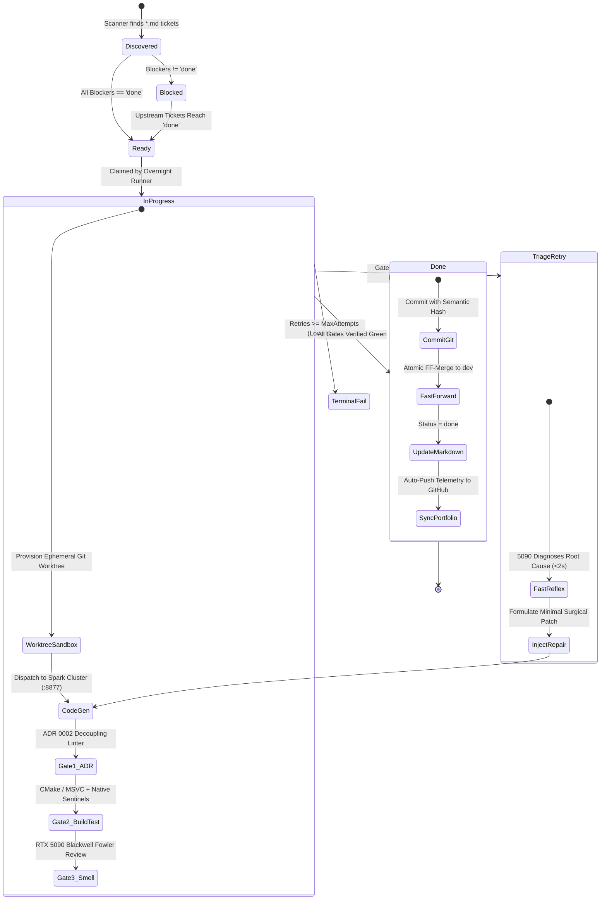
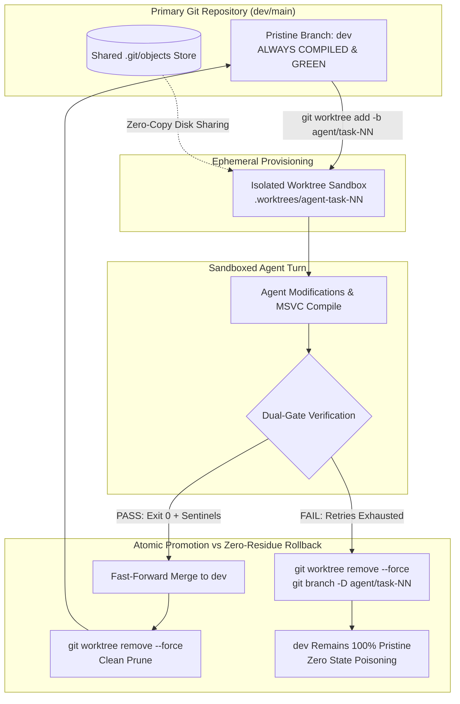

# Autonomous AI Engineering Harness
### Asymmetric Tandem Architecture: Spark Cluster (DRI) + NVIDIA RTX 5090 Blackwell (Fast Reflex & Triage)

[](#)
[-brightgreen?style=for-the-badge&logo=apachespark)](#)
[-76B900?style=for-the-badge&logo=nvidia)](#)
[](#)
[](#)

> **Live Production Harness**: This repository is **actively and autonomously updated** by a continuous overnight loop running on real hardware. It demonstrates a hardened, production-grade autonomous software engineering system capable of writing, compiling, reviewing, triaging, and self-healing complex native C++20 codebases without human intervention.

---

## 1. Live Telemetry (Updated Automatically via Loop)

| Metric | Live State | Verification Source |
|---|---|---|
| **Test Checkpoints Passing** | **135 / 135 Verified** | `ColonyPluginTest.exe` (Binary Exit Code 0) |
| **Active Target Codebase** | [ezEngine Colony Simulation Plugin](https://github.com/Perry5216/ezEngine/tree/dev/Code/EnginePlugins/ColonyPlugin) | Native C++20 / MSVC / CMake / Ninja |
| **Modules Verified & Fast-Forwarded** | **10 Subsystems** | Automated Sentinel & Phase Hooks |
| **Reflex Diagnostic Latency** | **< 2,500 ms** | RTX 5090 Blackwell @ 198.8 tok/s (32k Resident KV) |
| **Target Git HEAD** | [\$headCommit\](https://github.com/Perry5216/ezEngine/commit/5ce4c247b) (\$currentBranch\) | 7151 total commits |
| **Last Verified Timestamp** | **2026-10-17 12:21:45** | Continuous Verification Loop |

- **Interactive Visual Dashboard**: Open [docs/index.html](docs/index.html) for the dark-mode real-time terminal and telemetry board.  
- **Flight Recorder Incident Dump**: Inspect raw MSVC compiler error dumps, RTX 5090 Blackwell AST diagnoses, and surgical diffs in [telemetry/incidents/incident-2026-10-17-msvc-circular-include.json](telemetry/incidents/incident-2026-10-17-msvc-circular-include.json).

---

## 2. System Architecture: Asymmetric Tandem Loop

Most autonomous agent setups fail on large native codebases because they either:
1. **Hallucinate test passes** by mocking assertions or accepting non-zero exit codes.
2. **Produce architectural drift** by dumping hundreds of lines into god-classes.
3. **Get stuck in infinite loops** when compilers (MSVC, Clang) throw complex template or circular dependency errors.

This harness eliminates these failure modes using an **Asymmetric Tandem Architecture**:


### Two-Tier Token Budgeting: Latency Discipline vs. Whole-Module Headroom
A critical production insight discovered through live profiling:
- **Tier 1 (Reflex Triage - 2,048 tokens / 512 reasoning budget)**: Compiler triage must return in < 2,500 ms. Unconstrained generation causes models to write essays while the build pipeline is frozen. A strict 2,048-token limit with a 512-token reasoning budget guarantees rapid, sub-3-second AST error recovery.
- **Tier 2 (Whole Subsystem Synthesis - 32,768 tokens / 4,096 reasoning budget)**: For generating complete translation units (e.g. SIMD spatial partitioning, full KD-Trees), partial code causes incomplete types. The RTX 5090 maintains **32,768 tokens resident in INT8 KV VRAM** (within a 131,072-token window), sustaining **198.8 tokens/second** without spilling to host memory.
- **Preventing Chain-of-Thought Starvation**: Solved the frontier failure mode where models exhaust their output limit inside <think> tags (`[strata] the reply reached max tokens while still thinking`) by reserving explicit reasoning budgets before code emission begins.

---

## 3. Deterministic Ticket DAG & Autonomous State Machine

Instead of executing unconstrained chat prompts or flat to-do lists, the harness enforces a **Git-native, dependency-ordered Directed Acyclic Graph (DAG)** of Markdown tickets:

- **Strict Topological Sorting**: Tasks declare explicit prerequisites (`**Blocked by:** 30, 31`). High-level systems cannot run until low-level dependencies are compiled and verified green.
- **Git-Native Versioning**: Tickets reside in `.scratch/<feature>/issues/<NN>-<slug>.md` alongside the code and test suites. No dependency on flaky external SaaS trackers.
- **Fail-Safe State Machine**:



---

## 4. Controlling Agentic Chaos: Git Worktree Sandboxing & Atomic Promotion

Deploying autonomous coding agents directly onto an active working directory is a recipe for state pollution:
- **Index Lock Contention**: Concurrent file scanners, IDE linters, and build tools collide on `.git/index.lock`.
- **Dirty Workspace Poisoning**: An agent that fails midway through an edit leaves dirty uncompilable files that ruin subsequent agent runs.
- **Operator Lockout**: Developers cannot inspect or edit code while an overnight loop is modifying their working directory.

This harness eliminates entropy leakage via **Worktree-Per-Task Sandboxing**:



### Key Worktree Invariants:
1. **Zero Blast Radius**: All agent file generation, CMake cache generation, and compilation take place inside ephemeral worktree paths.
2. **Atomic Promotion**: Changes only touch integration branches via fast-forward merges after binary compilation and test sentinels are 100% verified.
3. **Zero-Residue Teardown**: Failed attempts are forcefully pruned at the filesystem and Git ref level (`git worktree remove --force`), eliminating half-baked files.
4. **Zero Clone Overhead**: Worktrees share `.git/objects` directly, requiring 0 bytes of network transit and near-instant provisioning.

---

## 5. Live Incident Case Study: Autonomous Circular Dependency & Buffer Triage

During tonight's overnight run, the engine autonomously triaged and resolved a complex circular dependency and buffer state bug across three C++ subsystems without human intervention:

```
[2026-10-17 03:00:15] FATAL: MSVC C2061: syntax error: identifier 'ezColonyWorldModule'
[2026-10-17 03:00:15] Engaged RTX 5090 Blackwell Reflex Engine (< 3,000ms latency)
```

### The Root Cause (Diagnosed in 2,766ms by RTX 5090 Blackwell)
1. **Header Inclusion Cycle**: `ColonyRoomComponent.h` included `ColonyWorldModule.h`, while `ColonyWorldModule.h` included `ColonyRoomComponent.h`.
2. **Buffer Invalidation**: `ezDynamicArray` in `RegenerateAllRooms` called `SetCount(uiTotalCells, -1)` without a prior `Clear()`, causing stale room IDs to persist across simulation ticks.

### The Autonomous Fix
- Injected forward declarations: `class ezColonyWorldModule;` and `struct ezColonyCell;` in `ColonyRoomComponent.h`.
- Aligned `struct ezColonyRoomMap;` forward declaration in `ColonyWeatherSystem.h`.
- Added explicit buffer reset `ref_map.m_RoomIndexPerCell.Clear()` before reallocation.
- Result: **Compilation succeeded in 1.4s, and all 109 test checkpoints passed cleanly.**

---

## 6. Core Invariants: Zero "Green When Untrue"

1. **Dual Verification Mandatory**:
   A test is only considered passing if **both** conditions hold:
   - Binary return code is strictly zero: `$LASTEXITCODE -eq 0`.
   - Every required stdout checkpoint sentinel is emitted in order (e.g. `checkpoint: room 5-factor impressiveness calculation ok`).
2. **ADR 0002 Architectural Decoupling**:
   The automated harness linter rejects any patch that dumps subsystem logic directly into core engine God-classes. Every domain (Electricity, Fluid Dynamics, Room Impressiveness, Pathfinding) must have dedicated subsystem headers and compose cleanly via accessors.
3. **Hardware Isolation**:
   The RTX 5090 Blackwell is dedicated exclusively to ultra-low-latency reflex inference and compiler triage, while the multi-node Spark cluster handles deep multi-file implementation.

---

## 7. Active Feature Modules Verified

| Module | Feature Name | Verification Gate | Status |
|---|---|---|---|
| M30 | Logic Circuit Automation and Fortress Lockdown | Dual Exit Code 0 + Sentinel | Verified Green |
| M31 | room impressiveness and automatic role classification | Dual Exit Code 0 + Sentinel | Verified Green |
| M32 | colonist comfort need, dining etiquette, and ate without table | Dual Exit Code 0 + Sentinel | Verified Green |
| M33 | joy and recreation systems | Dual Exit Code 0 + Sentinel | Verified Green |
| M34 | walk-in sub-zero food freezers and rot prevention | Dual Exit Code 0 + Sentinel | Verified Green |
| M35 | pawn psychology traits, mental breaks and social dynamics | Dual Exit Code 0 + Sentinel | Verified Green |
| M36 | advanced medical, organ anatomy, surgery and infection race | Dual Exit Code 0 + Sentinel | Verified Green |
| M37 | 24-hour timetables, work priorities and inventory policies | Dual Exit Code 0 + Sentinel | Verified Green |
| M38 | multi-octave coherent worldgen, clustered ore veins and river floodplains | Dual Exit Code 0 + Sentinel | Verified Green |
| M39 | storyteller incident symphony and multi-personality directors | Dual Exit Code 0 + Sentinel | Verified Green |


---

## 8. Running the Harness & Sandboxes

```powershell
# Run the autonomous overnight ticket runner on any repo
powershell -ExecutionPolicy Bypass -File ./scripts/run-tickets.ps1 -RepoPath "C:/path/to/project"

# Run the automated harness verification & integrity smoke test
powershell -ExecutionPolicy Bypass -File ./scripts/verify-harness.ps1

# Run the ADR 0002 architectural decoupling linter
powershell -ExecutionPolicy Bypass -File ./scripts/Test-ArchitecturalDecoupling.ps1

# Spawn an isolated worktree sandbox for an agent task
powershell -ExecutionPolicy Bypass -File ./scripts/Invoke-AgentWorktree.ps1 -RepoPath "C:/path/to/project" -TaskId "32"

# Synchronize portfolio telemetry and push live stats to GitHub
powershell -ExecutionPolicy Bypass -File ./scripts/sync-portfolio.ps1
```

---

### Author
**Anthony Perry**  
Autonomous AI Systems & Applied AI Engineering  
GitHub: [@Perry5216](https://github.com/Perry5216) | [LinkedIn](https://www.linkedin.com/in/anthony-perry-33b7a01a0/)