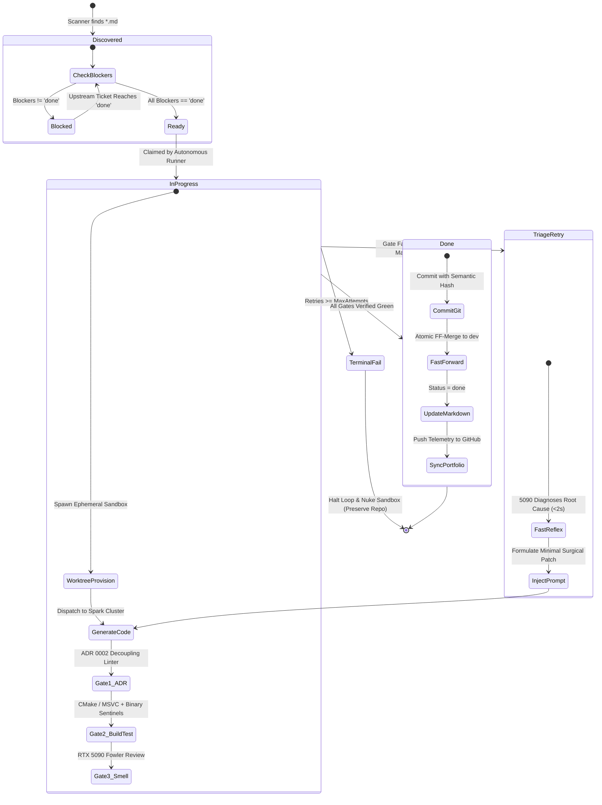

# Deterministic Ticket DAG & Autonomous State Machine

## 1. The Need for Structured Task Management

Naive autonomous agents typically operate from unconstrained chat prompts or flat to-do lists. In complex software systems, this produces critical failure modes:
1. **Out-of-Order Execution**: The model attempts to implement user-facing features (e.g. Colony Dining Buffs) before the prerequisite foundational layers (Room Role Classification, Impressiveness Calculations) are compiled and verified.
2. **Circular Deadlocks**: Without strict topological ordering, interdependent components end up in cyclic dependencies.
3. **Loss of Provenance**: When an agent completes work, there is no audit trail linking the verified test checkpoints to the original acceptance criteria.

Our harness solves this with a **Git-Native, Dependency-Ordered Directed Acyclic Graph (DAG)** of Markdown tickets.

---

## 2. The Ticket Schema

Every task is declared as a version-controlled Markdown file located in `.scratch/<feature>/issues/<NN>-<slug>.md` (or `.tickets/`):

```markdown
# 32: Colonist Comfort Need and Dining Etiquette

**Status:** ready-for-agent
**Blocked by:** 30, 31
**Priority:** High
**Owner:** Spark DRI (:8877) + RTX 5090 Blackwell (:8080)

## Context & Objectives
Implement colonist comfort decay and table dining etiquette according to ADR 0002.
Colonists eating without a table must receive a negative mood modifier, while dining
at a table in an impressive dining room applies comfort and mood restoration.

## Architectural Boundaries (ADR 0002)
- Must encapsulate logic in dedicated headers: `ColonyComfortComponent.h` / `ColonyComfortComponent.cpp`.
- Must NOT pollute `ColonyWorldModule.h` or `ColonyGrid.h`.
- Compose into `ezColonyWorldModule` via clean accessor.

## Deterministic Verification Checkpoints
- `checkpoint: colonist comfort need decay and chair restoration ok`
- `checkpoint: eating without table negative thought applied ok`
- `checkpoint: dining in impressive hall mood buff applied ok`

## Acceptance Gate
- Exit code strictly zero: `$LASTEXITCODE -eq 0`
- All 3 stdout sentinels emitted by `ColonyPluginTest.exe`
- 5090 Blackwell Fowler Smell Review: CLEAN
```

---

## 3. The Autonomous State Machine

The ticket lifecycle is strictly governed by a deterministic state machine:



---

## 4. Topological DAG Resolution

The runner continuously evaluates the dependency graph using topological sorting:

```powershell
function Find-NextUnblockedTicket([array]$tickets) {
    # Extract set of all completed ticket numbers
    $doneNumbers = @($tickets | Where-Object { $_.Status -eq "done" } | ForEach-Object { $_.Number })
    $readyTickets = $tickets | Where-Object { $_.Status -eq "ready-for-agent" -or $_.Status -eq "in-progress" } | Sort-Object Number

    foreach ($t in $readyTickets) {
        $b = $t.BlockedBy
        # If no blockers, ticket is immediately actionable
        if ($b -match "none" -or [string]::IsNullOrWhiteSpace($b)) {
            return $t
        }

        # Verify every blocker is already satisfied
        $isBlocked = $false
        foreach ($bNum in [regex]::Matches($b, '\b(\d+)\b') | ForEach-Object { [int]$_.Value }) {
            if ($doneNumbers -notcontains $bNum) {
                $isBlocked = $true
                break
            }
        }

        if (-not $isBlocked) {
            return $t
        }
    }
    return $null
}
```

---

## 5. Why Git-Native Beats External Web Issues

1. **Atomic Versioning**: Tickets live in the exact same Git tree as the implementation and tests. A branch contains the spec, the code, and the test results simultaneously.
2. **Offline & Cluster Resilient**: Zero reliance on external SaaS issue trackers (Jira, GitHub Issues API) that rate-limit or fail during high-throughput overnight batch runs.
3. **Full Auditability**: Every completed ticket is updated to `**Status:** done` in the exact commit where the passing code and test sentinels are introduced.
