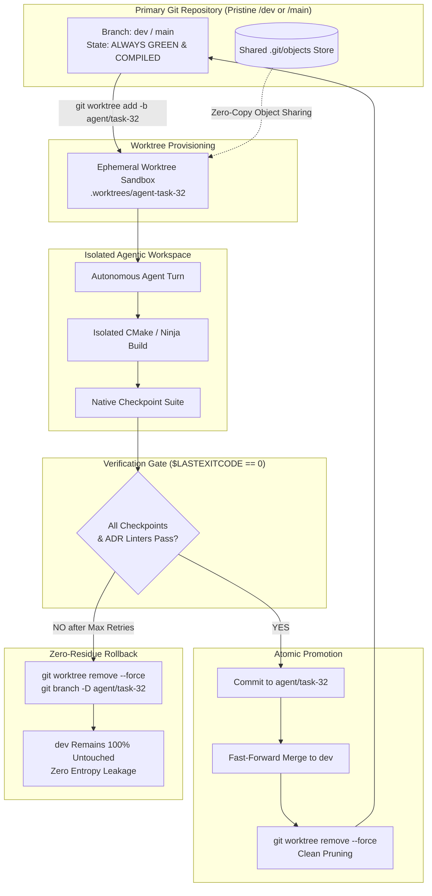

# Controlling Agentic Chaos: Git Worktree Sandboxing & Atomic Promotion

## 1. The Chaos Problem in Autonomous AI Workflows

The fundamental risk of deploying autonomous AI agents directly onto codebases is **entropy leakage**:
- **Dirty Workspace Poisoning**: An agent attempts a multi-file refactor, fails midway, and leaves 12 modified files with broken syntax. The next agent turn starts with a contaminated environment and immediately degrades.
- **Git Index Contention**: Simultaneous agent operations or background verification tools collide on `.git/index.lock`, causing hard crashes.
- **Operator Lockout**: If an autonomous loop operates directly on the developer's working directory, the developer cannot inspect, edit, or test code while the loop is running overnight.
- **Hallucinated Rollbacks**: Agents asked to "revert your changes" often attempt manual edits, leaving behind subtle phantom modifications and dead code.

---

## 2. The Worktree Sandboxing Architecture

To solve this, our harness enforces **Worktree-Per-Task Sandboxing**. Every autonomous operation takes place in an ephemeral Git worktree linked to the primary repository:



---

## 3. Key Operational Invariants

### 1. Zero Blast Radius (Complete Isolation)
- Agents have **zero write access** to the primary working copy.
- If an agent generates broken C++ headers, hallucinated functions, or corrupt build configurations, the entire blast radius is confined to `.worktrees/agent-task-NN/`.

### 2. Atomic Promotion
- Code is only merged into the integration branch (`dev` or `main`) after passing:
  1. **Gate 1**: Architectural linter (ADR 0002 decoupling check).
  2. **Gate 2**: Binary compilation (`cmake --build` exit code 0).
  3. **Gate 3**: Deterministic test sentinels (`checkpoint: ... ok`).
  4. **Gate 4**: Fowler code smell scan on the RTX 5090 Blackwell.
- Promotion is strictly **atomic**: either the entire verified feature is cleanly fast-forwarded, or nothing touches `dev`.

### 3. Zero-Residue Teardown
- On terminal failure or unrecoverable error, the harness issues:
  ```powershell
  git worktree remove --force $sandboxPath
  git branch -D $branchName
  ```
- The entire broken workspace is obliterated instantly at the filesystem and git ref level. No developer cleanup is ever required.

### 4. Zero Object Bloat (Shared Object Store)
- Linked git worktrees share the common `.git/` object database. Spawning an isolated workspace requires **zero clone time** and consumes negligible additional disk space.

---

## 4. Production PowerShell Implementation

Below is the production harness implementation used in our orchestrators:

```powershell
function Invoke-SandboxedAgentTask {
    param(
        [string]$RepoPath,
        [string]$TaskId,
        [scriptblock]$AgentAction,
        [scriptblock]$VerifyAction
    )

    $branchName = "agent/$TaskId"
    $sandboxPath = Join-Path $RepoPath ".worktrees\$TaskId"

    Write-Host "[Worktree] Provisioning isolated sandbox at $sandboxPath..." -ForegroundColor Cyan
    git -C $RepoPath worktree add -b $branchName $sandboxPath HEAD 2>&1 | Out-Null

    try {
        # Run agent in strictly isolated filesystem scope
        Push-Location $sandboxPath
        try {
            & $AgentAction -SandboxPath $sandboxPath
            
            # Run verification gates
            $verifyPassed = & $VerifyAction -SandboxPath $sandboxPath
            if (-not $verifyPassed) {
                throw "Verification gate failed in sandbox."
            }

            # Commit inside sandbox
            git add -A
            git commit -m "feat: verified task $TaskId" 2>&1 | Out-Null
        } finally {
            Pop-Location
        }

        # Atomic Promotion: Fast-forward merge into main branch
        Write-Host "[Worktree] Verification passed. Promoting atomically to main branch..." -ForegroundColor Green
        git -C $RepoPath merge --ff-only $branchName 2>&1 | Out-Null

    } catch {
        Write-Host "[Worktree] Task failed: $($_.Exception.Message). Nuking sandbox (zero residue)..." -ForegroundColor Yellow
    } finally {
        # Teardown: Prune worktree and purge branch
        git -C $RepoPath worktree remove --force $sandboxPath 2>&1 | Out-Null
        git -C $RepoPath branch -D $branchName 2>&1 | Out-Null
        git -C $RepoPath worktree prune 2>&1 | Out-Null
        Write-Host "[Worktree] Sandbox cleaned up successfully." -ForegroundColor Gray
    }
}
```
